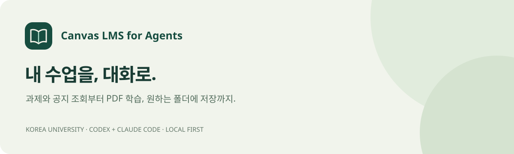

<p align="center"></p>

<p align="center"><a href="#설치">설치</a> · <a href="#이렇게-물어보세요">사용 예시</a> · <a href="#연결과-저장">연결과 저장</a> · <a href="docs/user-guide.md">상세 가이드</a> · <a href="SECURITY.md">보안</a></p>

고려대 **Canvas·LearningX**를 Codex와 Claude Code에서 조회하는 로컬 플러그인입니다. 과목명을 말하면 필요한 정보를 바로 찾고, PDF는 원문을 내려받아 함께 공부합니다. 별도 서비스 가입이나 AI API 키가 필요하지 않습니다.

> 학교 공식 서비스가 아닙니다. LMS는 **조회 전용**이며 과제 제출·출석 처리·자동 영상 시청은 제공하지 않습니다.

## 이렇게 물어보세요

```text
미적분 과제 뭐였지?
그중 아직 제출 안 한 것만 보여줘.
이 과제 첨부 PDF를 내려받아서 바탕화면의 미적분 폴더에 넣어줘.
알고리즘 이번 주 주차학습이랑 최근 공지 확인해줘.
인지 PDF 3~5 같이 공부하자.
과목들을 화면으로 보고 싶어. 대시보드 열어줘.
```

전체 과목 목록을 먼저 고를 필요 없이 **과목명과 원하는 정보**를 말하세요. 과목이 여러 분반에 걸치면 필요한 후보만 확인합니다. 후속 질문은 같은 과목에서 이어집니다.

| 필요한 일 | 응답과 동작 |
|---|---|
| 과제 확인 | 제목·마감(KST)·제출 상태를 짧게 정리. 미제출·제출 완료 필터 지원 |
| 공지·게시판 | Canvas 공지와 LearningX 글·첨부 조회. 긴 본문은 상세 조회 |
| 주차학습·출석 | 주차별 항목·마감·학교의 상태 조회. 미확인 상태는 그대로 표시 |
| PDF 학습 | 전체 다운로드·텍스트 추출·페이지 읽기·도표와 수식 이미지 확인 |
| 원하는 폴더에 저장 | 실제 폴더를 확인하고 PDF 사본 저장. 기존 파일·필기는 보존 |
| 화면으로 조회 | 요청할 때 로컬 대시보드에서 과목·메뉴·제출 상태를 클릭해 조회 |

대시보드는 **별도 로컬 브라우저 화면**입니다. 일반 조회는 채팅에서 바로 답합니다. PDF 이외 첨부의 자동 다운로드와 전체 OCR은 현재 지원하지 않습니다.

## 설치

준비: **Node.js 24 이상(npm 포함), Git, 로컬 Codex 또는 Claude Code**. 개발 저장소를 clone하거나 `npm ci`를 직접 실행할 필요는 없습니다. PDF 엔진은 첫 분석 때 고정된 lockfile로 자동 설치합니다.

### Codex

```bash
codex plugin marketplace add iamnotfemale/canvas-lms-for-agents
codex plugin add canvas-lms-for-agents@canvas-lms-for-agents
```

앱을 다시 시작하고 새 로컬 채팅에서 `@` → **Canvas LMS for Agents**를 선택하세요. `codex plugin`이 없으면 Codex를 업데이트하세요.

### Claude Code

```bash
claude plugin marketplace add iamnotfemale/canvas-lms-for-agents
claude plugin install canvas-lms-for-agents@canvas-lms-for-agents --scope user
```

재시작 후 `/canvas-lms-for-agents:canvas-lms 미적분 과제 보여줘`로 시작하세요.

## 연결과 저장

1. 첫 요청에서 자동으로 열리는 **로컬 연결 화면**을 엽니다.
2. 본인의 고려대 Canvas 설정 → 승인된 통합에서 만든 **Canvas 개인 액세스 토큰**을 입력합니다. GitHub 토큰이 아닙니다.
3. **연결하고 시작하기**를 누른 뒤 같은 채팅으로 돌아갑니다. 앱 재시작은 필요 없습니다.

각 사용자는 본인 컴퓨터에서 본인 계정으로 실행합니다. 토큰·PDF·캐시는 사용자별 로컬 설정에 보관하며 플러그인 패키지나 GitHub에 포함하지 않습니다. **토큰을 채팅·이슈·GitHub Secrets에 올리지 마세요.**

기본 PDF 보관 위치:

```text
바탕화면 / Canvas LMS / 학기 / 과목 / 실제 파일명.pdf
```

“이 폴더에 넣어줘”라고 하면 지정한 폴더에 사본을 저장합니다. 내부 캐시를 정리해도 보관본은 유지됩니다. 클라우드 실행 환경은 내 PC 파일시스템과 다르므로, 내 컴퓨터의 폴더에 저장하려면 로컬 실행이 필요합니다.

설정은 `~/.config/canvas-lms-for-agents/config.json`에 저장합니다. OS 파일 권한으로 보호하지만 암호화 저장소는 아닙니다. PDF 분석에 사용하는 텍스트·이미지는 이용 중인 AI 앱에 전달됩니다. 자세한 내용은 [데이터 흐름](SECURITY.md)을 확인하세요.

개인 토큰 방식은 본인 계정의 개인 개발·테스트를 위한 방식입니다. 다른 사용자에게 수동 토큰 입력을 요구하는 앱의 배포에는 [Canvas 인증 정책](https://developerdocs.instructure.com/services/canvas/oauth2/file.oauth)과 학교 조건을 확인해야 하며, 다중 사용자 서비스의 OAuth 전환은 별도 범위입니다.

## 연결이 안 될 때

| 증상 | 해결 |
|---|---|
| 예전 화면에서 `Forbidden` | 플러그인을 업데이트하고 채팅에서 “연결 설정 다시 열어줘” 요청. 예전 탭 대신 새 화면 사용 |
| 토큰 만료·401 | “연결 상태 확인해줘”로 진단하고 새 토큰으로 교체 |
| 학교의 HTTP 403 | 폼 저장 오류와 다릅니다. Canvas 로그인·계정 권한·학교 정책 확인 |
| 저장 실패 | 대상 폴더의 실제 경로·쓰기 권한·디스크 공간 확인 |
| 자료가 안 보임 | 과목명·학기·분반 확인. 일부 경로 조회 실패는 별도 표시 |
| 화면 링크 만료 | “대시보드 다시 열어줘”. 로컬 화면은 다른 사람과 공유하는 링크가 아닙니다 |

## 업데이트

Codex:

```bash
codex plugin marketplace upgrade canvas-lms-for-agents
codex plugin remove canvas-lms-for-agents@canvas-lms-for-agents
codex plugin add canvas-lms-for-agents@canvas-lms-for-agents
```

Claude Code:

```bash
claude plugin marketplace update canvas-lms-for-agents
claude plugin update canvas-lms-for-agents@canvas-lms-for-agents
```

앱을 다시 시작해 새 채팅에서 사용하세요. 기존 토큰과 보관본은 유지됩니다. 이 명령은 저장소의 배포 버전을 설치하며, 아직 공개하지 않은 로컬 변경까지 설치하지는 않습니다.

## 개발

```bash
npm ci
npm run build
npm test
npm run check
```

Node.js 24+, Linux·Windows CI. `src/`는 공유 런타임, `plugin/`은 설치 패키지입니다. 런타임 수정 시 번들을 다시 빌드합니다. 테스트는 합성 데이터만 사용합니다. `scripts/verify-live.mjs`는 본인 토큰을 설정한 뒤 명시적으로 실행하는 선택 검사입니다.

[설계](docs/design.md) · [검증 기록](docs/verification.md) · [배포 체크](docs/releasing.md) · [상세 가이드](docs/user-guide.md)

MIT License · 고려대학교·Instructure·OpenAI·Anthropic의 공식 플러그인이 아닙니다.
